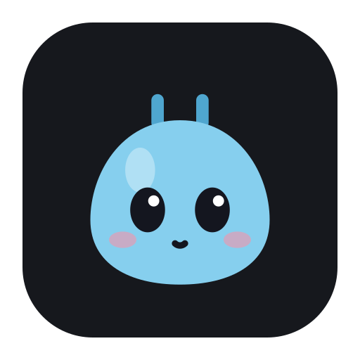

<p align="center"></p>

<h1 align="center">Nexus</h1>

<p align="center">Integração entre um PC Linux (GNOME) e celulares e tablets Android, no estilo da "Continuidade" da Apple.<br>
Tudo é próprio, sem KDE Connect nem Zorin Connect, cifrado de ponta a ponta e sem precisar de root.</p>

## O que faz

**Áudio**
- O som do PC toca no celular ou no tablet, com cerca de 115 ms de atraso.
- O som dos apps do celular e do tablet toca no PC, **de vários aparelhos ao mesmo tempo**. O PipeWire mistura todos, e cada aparelho tem o próprio volume nas Configurações de som. O PC pergunta antes, com as opções de permitir uma vez, sempre ou negar.

**Teclado e mouse**
- Um teclado e um mouse para todos: o cursor atravessa a borda do monitor e passa a controlar o celular, o tablet ou outro PC. A ideia vem do [Beamer](https://github.com/kalkman-code/beamer).
- Cada aparelho fica no lado e no trecho da borda que você escolher, num editor como o de Configurações → Telas.
- Por adb (cabo ou depuração sem fio) ou por **Bluetooth LE**: o PC vira um teclado e mouse Bluetooth de verdade, sem depuração.

**Arquivos, texto e ações**
- Arquivos nos dois sentidos, com progresso e cancelamento. Os recebidos vão para `~/Downloads/Nexus`.
- Texto, área de transferência e links nos dois sentidos.
- O celular pode executar ações do PC liberadas uma a uma, como tocar/pausar, bloquear a tela e notificar. Nunca roda comandos do shell.
- Espelhar a tela do celular no PC com [scrcpy](https://github.com/Genymobile/scrcpy).

**No topo da tela**
- Um notch dentro da extensão [Balão](https://github.com/JvFontenele/balao), com o mascote Nexo: aparelhos, áudio, transferências e pareamento.
- **Aprovar os pedidos de permissão do Claude Code** pelo notch (Negar, Permitir, Sempre ou "No terminal"). Se algo falhar, o terminal pergunta: o Nexus nunca aprova sozinho.

## Segurança
- Pareamento com código de 6 dígitos conferido nos dois lados (SAS com commit/reveal) e um certificado por aparelho.
- TLS 1.3 com autenticação mútua. Quem decide se um aparelho é confiável é a lista de pareados (`trusted.json`), e cada aparelho pode ser revogado.
- Permissões por aparelho, desligadas por padrão: ações remotas, ser controlado pelo teclado e mouse, mandar o próprio áudio ao PC.
- O log guarda só eventos, nunca conteúdo.
- Nada pede root. A porta 47210/tcp fica aberta só para a rede local e para a tailnet.

## Instalar no PC
Feito para o Zorin OS 18 / Ubuntu 24.04 (GNOME 46, Wayland, PipeWire). Precisa de Python 3.12 com GTK 4 e libadwaita (`gi`).

```bash
packaging/install.sh            # nexusd como serviço do usuário (sem root), "Nexus" no menu e o ícone
sudo apt install scrcpy adb     # opcional: espelhar a tela e o teclado e mouse por adb
```

Libere a porta só para a sua rede, por exemplo com o ufw:
`sudo ufw allow from 192.168.0.0/24 to any port 47210 proto tcp`

Depois de trocar de rede, rode `systemctl --user restart nexusd`.

## Instalar no Android
Android 10 ou mais novo. Compile o app em `android/` (Kotlin + Jetpack Compose; ver `CLAUDE.md`) e instale com `adb install`.

No HyperOS, na One UI e em outros sistemas que fecham apps em segundo plano, libere o Nexus da otimização de bateria. O app tem um guia em **Ajustes → Manter o Nexus ligado**.

## Usar
1. No app do celular, toque em **Procurar** e depois em **Parear**.
2. Confira o código no PC (no notch, no app Nexus ou com `nexus pair confirm <id>`) e no celular.
3. No app Nexus do PC, cada aparelho tem três abas: **Início** (ações), **Teclado e mouse** (borda e posição) e **Permissões**. As opções gerais ficam em ☰ → **Preferências** (Ctrl+,).
4. No celular, a barra inferior tem **Início**, **Áudio**, **Arquivos** e **Ajustes**.

Linha de comando: `nexus devices`, `nexus pair`, `nexus mirror`, `nexus control`, `nexus peer`, `nexus agents`, `nexus app`. Use `nexus --help` para ver todos.

## Peças
| Pasta | O quê |
|---|---|
| `nexus/` | `nexusd` (Python 3.12, asyncio, só stdlib + `gi`): protocolo, pareamento, ações, áudio (PipeWire), arquivos, teclado e mouse (portal InputCapture, Bluetooth LE), D-Bus; app GTK; CLI |
| `android/` | app Android (Kotlin + Jetpack Compose, minSdk 29) |
| `packaging/` | serviço systemd **de usuário**, atalho no menu, ícone (`icone.py` gera a partir do mascote) |
| `docs/` | [protocolo v1](docs/protocol/v1.md), decisões ([ADRs 0001–0006](docs/architecture/decisions/)), [repositórios de referência](docs/research/referencias.md) |
| `tests/` | `python3 -m unittest discover -s tests` (inclui TLS real e D-Bus em barramento privado) |

## Licença
GPL-3.0 (`LICENSE`).
